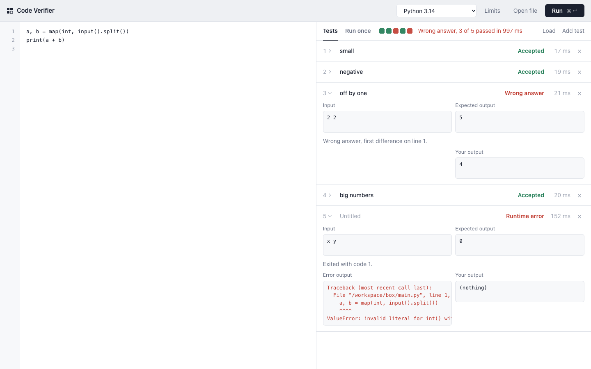

# Code Verifier Sandbox

A local service that takes untrusted source code and a list of test cases, compiles the code once, runs it against every test inside throwaway Docker containers and tells you exactly how each test went. Think of it as the judging backend of an online judge (LeetCode, Codeforces) that you run on your own machine.

It supports **C, C++, Go, Java, JavaScript, Python and Rust**. You use it from a **web page in your browser**, from the `verifierctl` command line client, or from your own programs over **gRPC** or plain **HTTP/JSON**.



## Contents

- [What it does](#what-it-does)
- [Requirements](#requirements)
- [Quick start](#quick-start)
- [Using the web interface](#using-the-web-interface)
- [Using the command line client](#using-the-command-line-client)
- [HTTP API](#http-api)
- [gRPC API](#grpc-api)
- [Requests, limits and verdicts](#requests-limits-and-verdicts)
- [Languages](#languages)
- [Configuration](#configuration)
- [How the sandbox works](#how-the-sandbox-works)
- [Testing](#testing)
- [Project layout](#project-layout)
- [Changing the API](#changing-the-api)
- [Troubleshooting](#troubleshooting)
- [Removing everything](#removing-everything)
- [License](#license)

## What it does

- **A web interface** built into the server. Write or open code, set up tests and watch each verdict come in, or just run the code once to see what it prints. Nothing extra to install.
- **Seven languages** with pinned, official Docker images.
- **Compiles once, then runs each test in a fresh container**, so tests can't influence each other and compiled languages don't pay the compile cost per test.
- **Real verdicts per test.** `ACCEPTED`, `WRONG_ANSWER`, `TIME_LIMIT_EXCEEDED`, `MEMORY_LIMIT_EXCEEDED`, `OUTPUT_LIMIT_EXCEEDED`, `RUNTIME_ERROR`, `COMPILATION_ERROR`, `INTERNAL_ERROR` and `SKIPPED`, plus a readable message such as `wrong answer, first difference on line 3` or `killed by SIGSEGV (segmentation fault)`.
- **Detailed results.** Each test reports stdout, stderr, exit code and run time. Compiler errors come back as text.
- **Three ways to compare output.** Exact, ignoring trailing whitespace (the default, like most judges) or token by token.
- **Per request limits** for time and memory, within maximums set by the server.
- **Streaming.** You can get the compile result and each test result as soon as they are ready, over gRPC or as NDJSON over HTTP.
- **Hardened containers.** No network, read-only filesystem, non-root user, no Linux capabilities, process limit, memory limit without swap and an output size cap. See [How the sandbox works](#how-the-sandbox-works).
- **Safe under load.** A fixed number of submissions run at once, others wait in a bounded queue and the rest get a clear "busy" error.
- **Cleans up after itself.** Containers and volumes are removed after every submission, when a client disconnects, on shutdown, and on the next start if the process was killed.
- **Health checks.** `/healthz` and `/readyz` over HTTP and the standard gRPC health service. gRPC reflection is on, so tools like `grpcurl` work without the proto file.
- **Local only by default.** Both servers listen on `127.0.0.1`, and the HTTP API refuses requests from web pages (other origins, DNS rebinding, form posts). There is no authentication, so don't expose the ports to a network.

## Requirements

| What | Version | Notes |
| --- | --- | --- |
| Go | 1.25 or newer | Only needed to build. `brew install go` on macOS. |
| Docker | Docker Desktop, or Docker Engine 25 or newer | Must be running. Tested with Docker Desktop on macOS (Apple Silicon), Engine 29. Linux with Docker Engine should work the same way. |
| make | any | Optional, every command is also shown without it. Comes with the Xcode command line tools on macOS. |
| Disk space | about 4.6 GB | For all seven language images. Enable fewer languages to download less. |

`protoc` is **not** needed unless you change the `.proto` file. The generated Go code is checked in.

## Quick start

```bash
git clone https://github.com/YaserBadwan/code-verifier-sandbox.git
cd code-verifier-sandbox

# make sure Docker Desktop (or the docker daemon) is running, then
make run
```

`make run` builds the server, starts it and opens **http://127.0.0.1:8080** in your browser. Leave the terminal open while you use it. The page starts with a small example (add two numbers) and two tests, so you can press **Run** right away.

The first start downloads the language images in the background, about 4.6 GB in total. The page shows a language as "downloading" until its image is ready. To download everything up front instead, run `make images` once before `make run`.

Stop the server with `Ctrl+C`. It finishes running submissions first, up to 30 seconds. Press `Ctrl+C` twice to quit right away.

Without make, the same steps are

```bash
go build -o bin/verifier ./cmd/verifier
go build -o bin/verifierctl ./cmd/verifierctl
./bin/verifier -pull-only   # optional, downloads every image up front
./bin/verifier -open
```

`make help` lists every make command.

To check everything from the terminal instead, run `make example` in a second terminal while the server is up. You should see `ACCEPTED  4/4 passed`.

**Only need some languages?** Set `VERIFIER_LANGUAGES` for both steps, for example

```bash
VERIFIER_LANGUAGES=python,cpp make images
VERIFIER_LANGUAGES=python,cpp make run
```

When the server is up you'll see

```
level=INFO msg="connected to docker" host=unix:///Users/you/.docker/run/docker.sock runtime=default
level=INFO msg="verifier is running" web=http://127.0.0.1:8080 grpc=127.0.0.1:50051 languages=c,cpp,go,java,javascript,python,rust
level=INFO msg="ready to take submissions"
```

## Using the web interface

Open **http://127.0.0.1:8080** while the server runs (`make run` does it for you).

- **Code.** Pick a language at the top, then write in the editor on the left or use **Open file** to load a source file. The language is picked from the file extension. The editor keeps your code per language and remembers it between visits.
- **Tests.** Each test on the right has an input and an expected output. **Add test** adds one, × removes it, and the name is optional. **Load** replaces them with a `tests.json` file or with `.in` and `.out` files (select several at once, `1.in` pairs with `1.out` or `1.ans`).
- **Limits.** Time and memory per test, how output is compared, and whether to stop at the first failure. Empty fields use the server defaults.
- **Run** (or ⌘↵ on a Mac, Ctrl+Enter elsewhere). The row of squares next to Tests fills in as each test finishes, green for accepted, red for a wrong answer or error, amber for a limit hit. Click a square to jump to its test. While a run is going the button says **Stop**, which cancels it on the server too.
- **Results.** Passing tests fold up so failures stand out. A failing test shows why it failed, your program's output right under the expected output, and anything it printed to stderr. Click a test's header to fold or unfold it. If compiling fails, the compiler's message appears under the editor.
- **Run once.** To just see what your code does, switch to the **Run once** tab next to Tests. Type the input your program should read (or leave it empty) and press Run. You get its output, its error output, how long it took, and a clear message if it crashed, ran out of time or memory, or didn't compile. Nothing is compared and your tests stay as they are. The same sandbox and limits apply.

In the editor, Tab and Shift+Tab indent and outdent (the whole selection when several lines are selected), and Enter keeps the indentation. Press Escape then Tab to move focus out of the editor with the keyboard.

The page follows your system's light or dark setting and works on a phone. It loads nothing from the internet, everything is served by the verifier itself.

## Using the command line client

`verifierctl` talks to the server over gRPC. Build it with `make build`.

```bash
./bin/verifierctl run -file solution.cpp -tests tests.json
./bin/verifierctl languages
./bin/verifierctl health
```

### `run` options

| Flag | Default | Meaning |
| --- | --- | --- |
| `-file` | required | Source file to verify. |
| `-tests` | required | A JSON file of test cases, or a folder of `.in` and `.out` files (see below). |
| `-lang` | from the file extension | Language id or alias, for example `python`, `cpp`, `js`. |
| `-time-limit` | server default (3000) | Per test time limit in milliseconds. |
| `-memory` | server default (256) | Per test memory limit in MB. |
| `-compare` | `trailing` | `exact`, `trailing` or `tokens`. See [comparison modes](#comparison-modes). |
| `-fail-fast` | off | Skip the remaining tests after the first failure. |
| `-show-output` | off | Print stdout and stderr of failed tests. |
| `-json` | off | Print the full result as JSON instead of the table. |
| `-addr` | `127.0.0.1:50051` | Server address. The `VERIFIER_ADDR` environment variable works too. |

Exit codes are `0` when every test passed, `1` when the submission was rejected (any other verdict) and `2` when something went wrong (bad flags, server not running and so on). Pressing `Ctrl+C` cancels the submission on the server too.

### Test files

A JSON array, or an object with a `test_cases` array. `name` is optional.

```json
[
  { "name": "small", "input": "1 2\n", "expected_output": "3\n" },
  { "name": "negative", "input": "-5 5\n", "expected_output": "0\n" }
]
```

Or a folder where every `NAME.in` has a matching `NAME.out` (or `NAME.ans`). Tests run in natural order, so `2.in` comes before `10.in`.

```
tests/
  1.in   1.out
  2.in   2.ans
  10.in  10.out
```

### Example of a failing run

```
$ ./bin/verifierctl run -file sq.py -tests t.json -show-output
compiled in 186 ms
test 1  two           ACCEPTED  29 ms
test 2  three         WRONG_ANSWER  24 ms  wrong answer, first difference on line 1
  stdout
    9
test 3  negative one  RUNTIME_ERROR  129 ms  exited with code 1
  stderr
    Traceback (most recent call last):
      File "/workspace/box/main.py", line 4, in <module>
        raise ValueError("negative")
    ValueError: negative
test 4                ACCEPTED  24 ms

WRONG_ANSWER  2/4 passed in 950ms  (submission 7dbad62c7e8e140a)
```

## HTTP API

Base URL `http://127.0.0.1:8080`. Requests and responses are JSON, and `POST /v1/verify` must be sent with the header `Content-Type: application/json` (curl's `-d` alone sends a form type, so always add `-H 'Content-Type: application/json'`). The JSON uses the same field names as the proto file. Responses use `snake_case`, and requests accept both `snake_case` and `camelCase`. Unknown fields are rejected, so typos don't get silently ignored.

| Method and path | What it does |
| --- | --- |
| `GET /` | The web interface. |
| `POST /v1/verify` | Verify a submission and return the full result. |
| `POST /v1/verify?stream=true` | Same, but streams NDJSON lines as results come in. |
| `GET /v1/languages` | Enabled languages and whether each image is ready. |
| `GET /healthz` | Always `200` while the process is alive. |
| `GET /readyz` | `200` when Docker answers and every enabled image is present, `503` otherwise, with details. |

### Verify

```bash
curl -s -X POST http://127.0.0.1:8080/v1/verify \
  -H 'Content-Type: application/json' \
  -d '{
    "language": "python",
    "source_code": "print(int(input()) * 2)",
    "test_cases": [
      { "name": "ok",  "input": "2", "expected_output": "4" },
      { "name": "bad", "input": "3", "expected_output": "7" }
    ],
    "time_limit_ms": 2000,
    "memory_limit_mb": 128,
    "compare_mode": "COMPARE_MODE_IGNORE_TRAILING_WHITESPACE",
    "stop_on_first_failure": false
  }'
```

```json
{
  "submission_id": "9f962a14b9b097a8",
  "verdict": "VERDICT_WRONG_ANSWER",
  "compile": { "success": true, "output": "", "duration_ms": 173 },
  "results": [
    {
      "index": 0, "name": "ok", "verdict": "VERDICT_ACCEPTED",
      "stdout": "4\n", "stderr": "", "stdout_truncated": false, "stderr_truncated": false,
      "exit_code": 0, "duration_ms": 29, "message": ""
    },
    {
      "index": 1, "name": "bad", "verdict": "VERDICT_WRONG_ANSWER",
      "stdout": "6\n", "stderr": "", "stdout_truncated": false, "stderr_truncated": false,
      "exit_code": 0, "duration_ms": 21, "message": "wrong answer, first difference on line 1"
    }
  ],
  "passed": 1,
  "total": 2,
  "duration_ms": 562
}
```

Note that a rejected submission is still a successful request, so the status is `200`. Look at `verdict`.

### Streaming

With `?stream=true` the response is `application/x-ndjson`, one JSON object per line. There is one `compile` line, then one `test_result` line per test in order, then one `summary` line holding the same object the non streaming call returns.

```
{"compile":{"success":true,"output":"","duration_ms":163}}
{"test_result":{"index":0,"name":"","verdict":"VERDICT_ACCEPTED","stdout":"9", ...}}
{"test_result":{"index":1,"name":"","verdict":"VERDICT_ACCEPTED","stdout":"16", ...}}
{"summary":{"submission_id":"fd2da85d384a5a5a","verdict":"VERDICT_ACCEPTED", ...}}
```

Problems found before the first line (bad request, unknown language) come back as a normal error response with the right status code. If something breaks after streaming started, the last line is an `{"error": ...}` object instead of a `summary`.

### Errors

Every error has the same shape

```json
{ "error": { "code": "INVALID_ARGUMENT", "message": "time_limit_ms must be between 100 and 15000" } }
```

| HTTP status | `code` | When |
| --- | --- | --- |
| 400 | `INVALID_ARGUMENT` | Bad JSON, unknown field, unknown language, empty source, no tests, too many tests, limits out of range. |
| 400 | `FAILED_PRECONDITION` | The language exists but is disabled on this server. |
| 403 | `PERMISSION_DENIED` | The request came from a web page whose origin isn't allowed, or used a `Host` other than `localhost`, `127.0.0.1` or `::1`. See below. |
| 404 | `NOT_FOUND` | Unknown path. |
| 405 | `METHOD_NOT_ALLOWED` | Wrong HTTP method. The `Allow` header says which one is right. |
| 413 | `RESOURCE_EXHAUSTED` | Body larger than `max-request-mb`. |
| 415 | `INVALID_ARGUMENT` | `Content-Type` is not `application/json`. |
| 429 | `RESOURCE_EXHAUSTED` | Too many submissions waiting. Try again shortly. |
| 503 | `UNAVAILABLE` | The language image is still downloading. |
| 500 | `INTERNAL` | Docker failed in an unexpected way. The server log has details. |

### Calling it from a browser

Since the service runs code, it has to make sure a random web page you happen to open can't use it behind your back. Browsers send an `Origin` header with every cross site request, so

- requests carrying an `Origin` that isn't listed in `-cors-origins` are refused with `403`,
- `POST /v1/verify` only accepts `application/json`, which forces the browser to ask permission first (a CORS preflight),
- while the server listens on loopback (the default), the `Host` header must be `localhost`, `127.0.0.1` or `::1`, which defeats DNS rebinding.

The verifier's own web page is always allowed, since it comes from the same address. Clients that aren't browsers (curl, `verifierctl`, your backend) send no `Origin` and aren't affected. To let another local web app call the API, list its origin.

```bash
VERIFIER_CORS_ORIGINS=http://localhost:3000 make run
```

If you bind `-http-addr` to a non loopback address on purpose, the `Host` check is turned off because the server can't know which names clients will use.

## gRPC API

Address `127.0.0.1:50051`, no TLS. The service is defined in [`proto/verifier/v1/verifier.proto`](proto/verifier/v1/verifier.proto).

```proto
service VerifierService {
  rpc Verify(VerifyRequest) returns (VerifyResponse);
  rpc VerifyStream(VerifyRequest) returns (stream VerifyEvent);
  rpc ListLanguages(ListLanguagesRequest) returns (ListLanguagesResponse);
}
```

Generated Go code lives in `proto/verifier/v1`, so a Go client only needs

```go
import verifierv1 "github.com/YaserBadwan/code-verifier-sandbox/proto/verifier/v1"

conn, _ := grpc.NewClient("127.0.0.1:50051", grpc.WithTransportCredentials(insecure.NewCredentials()))
client := verifierv1.NewVerifierServiceClient(conn)
resp, err := client.Verify(ctx, &verifierv1.VerifyRequest{
    Language:   "go",
    SourceCode: src,
    TestCases:  []*verifierv1.TestCase{{Input: "1 2\n", ExpectedOutput: "3\n"}},
})
```

For other languages, generate a client from the proto file. Errors use the standard gRPC status codes listed in the HTTP table above (`InvalidArgument`, `FailedPrecondition`, `ResourceExhausted`, `Unavailable`, `Internal`, `Canceled`). Requests are limited to `max-request-mb` (32 MB by default).

A `Verify` response holds up to 64 KB of stdout and 64 KB of stderr per test, so with many tests that print a lot it can grow past the 4 MB that gRPC clients accept by default. Either raise the client limit (`grpc.MaxCallRecvMsgSize`, `verifierctl` already uses 256 MB) or use `VerifyStream`, where every test arrives as its own small message.

The standard health service (`grpc.health.v1.Health`) reports `SERVING` once Docker answers and every image is present. Server reflection is enabled, so if you have [grpcurl](https://github.com/fullstorydev/grpcurl) installed you can call it without the proto file.

```bash
grpcurl -plaintext 127.0.0.1:50051 list
grpcurl -plaintext -d '{"language":"python","source_code":"print(input())","test_cases":[{"input":"hi","expected_output":"hi"}]}' \
  127.0.0.1:50051 verifier.v1.VerifierService/Verify
```

## Requests, limits and verdicts

### Request fields

| Field | Required | Meaning |
| --- | --- | --- |
| `language` | yes | Language id or alias, case insensitive. See [Languages](#languages). |
| `source_code` | yes | The program. Up to `max-source-kb` (256 KB). |
| `test_cases` | yes | 1 to `max-tests` (100) items with `input`, `expected_output` and an optional `name`. |
| `time_limit_ms` | no | Wall clock limit per test, 100 to `max-time-limit` (15000). `0` or missing means `default-time-limit` (3000). |
| `memory_limit_mb` | no | Memory limit per test, 32 to `max-memory-mb` (1024). `0` or missing means `default-memory-mb` (256). |
| `compare_mode` | no | See below. |
| `stop_on_first_failure` | no | Remaining tests are reported as `SKIPPED` after the first failure. |

The input is passed to the program on stdin, and stdin is closed afterwards so programs reading until EOF finish normally. Only stdout is compared, stderr is reported but never judged.

### Comparison modes

| Mode | Behaviour |
| --- | --- |
| `COMPARE_MODE_IGNORE_TRAILING_WHITESPACE` (default) | Ignores spaces, tabs and `\r` at the end of each line and empty lines at the end. `3` matches `3\n` and `3  \r\n`, but `3 4` does not match `3  4`. |
| `COMPARE_MODE_EXACT` | Byte for byte, so a missing final newline is a wrong answer. |
| `COMPARE_MODE_TOKENS` | Splits both sides on any whitespace and compares the pieces. `1 2 3` matches `1\n2\n3`. |

### Verdicts

Each test gets one verdict, picked in this order.

| Verdict | Meaning |
| --- | --- |
| `TIME_LIMIT_EXCEEDED` | Still running at the time limit, so it was killed. |
| `OUTPUT_LIMIT_EXCEEDED` | Wrote more than `output-limit-kb` (1 MB) to stdout or stderr, so it was killed. |
| `MEMORY_LIMIT_EXCEEDED` | Killed by the kernel for using too much memory (Docker reports it as OOM killed), or the runtime itself reported running out (`MemoryError`, `OutOfMemoryError`, `std::bad_alloc` and similar). |
| `RUNTIME_ERROR` | Non zero exit code or killed by a signal. The message says which, for example `exited with code 1` or `killed by SIGSEGV (segmentation fault)`. |
| `WRONG_ANSWER` | Exited normally but the output doesn't match. The message says where it first differs. |
| `ACCEPTED` | Output matches. |
| `COMPILATION_ERROR` | Set on the submission when compiling failed. Every test is then `SKIPPED`. |
| `SKIPPED` | Not run, because compiling failed or because of `stop_on_first_failure`. |
| `INTERNAL_ERROR` | Docker itself failed while running this test. Other tests still run. |

The submission verdict is `ACCEPTED` when every test passed, otherwise it's the verdict of the first test that didn't pass.

The reported stdout and stderr are cut to 64 KB per test (`stdout_truncated` and `stderr_truncated` tell you when). Bytes that aren't valid UTF-8 are replaced with `�` in the report, but comparison always uses the raw bytes.

`duration_ms` is wall clock time from process start to exit, so it includes runtime startup, which is a few tens of milliseconds for the JVM, Node and Python.

## Languages

| Id | Aliases | Image | Compile step | Notes |
| --- | --- | --- | --- | --- |
| `c` | | `gcc:15` | `gcc -O2 -std=gnu17 -lm` | |
| `cpp` | `c++`, `cxx` | `gcc:15` | `g++ -O2 -std=gnu++20` | `<bits/stdc++.h>` works. |
| `go` | `golang` | `golang:1.27-alpine` | `go build` | Standard library only, no `go.mod`. |
| `java` | | `eclipse-temurin:25-jdk-alpine` | `javac` | The public class must be called `Main`. Heap is up to 75% of the memory limit, thread stack is 1/8 of it (4 to 64 MB). |
| `javascript` | `js`, `node`, `nodejs` | `node:24-alpine` | `node --check` (syntax only) | Both `require` and `import` work, top level `await` too. |
| `python` | `py`, `py3`, `python3` | `python:3.14-alpine` | `py_compile` (syntax only) | Standard library only. |
| `rust` | `rs` | `rust:1.99-alpine` | `rustc -O --edition 2021` | Standard library only, no crates. |

No third party packages are available in any language and nothing can be downloaded, because the sandbox has no network.

For Python and JavaScript the "compile" step is a syntax check, so a syntax error is reported once as `COMPILATION_ERROR` instead of failing every test.

The `examples/sum` folder has a solution to the same problem (add two integers) in every language, plus `tests.json`.

```bash
for f in examples/sum/solution.* examples/sum/Main.java; do
  ./bin/verifierctl run -file "$f" -tests examples/sum/tests.json
done
```

## Configuration

Every setting is a flag and an environment variable. Flags win over environment variables. `./bin/verifier -h` prints this list too.

| Flag | Environment variable | Default | Meaning |
| --- | --- | --- | --- |
| `-grpc-addr` | `VERIFIER_GRPC_ADDR` | `127.0.0.1:50051` | gRPC listen address. |
| `-http-addr` | `VERIFIER_HTTP_ADDR` | `127.0.0.1:8080` | HTTP listen address. |
| `-languages` | `VERIFIER_LANGUAGES` | `all` | Comma separated ids to enable, for example `python,cpp`. |
| `-pull-images` | `VERIFIER_PULL_IMAGES` | `true` | Download missing images in the background at startup. |
| `-pull-only` | `VERIFIER_PULL_ONLY` | `false` | Download the images for the enabled languages, then exit. |
| `-open` | `VERIFIER_OPEN` | `false` | Open the web interface in your default browser once the server is up. `make run` turns it on. |
| `-runtime` | `VERIFIER_RUNTIME` | Docker default | Container runtime, for example `runsc` for gVisor. |
| `-max-concurrent` | `VERIFIER_MAX_CONCURRENT` | `4` | Submissions processed at the same time (1 to 64). |
| `-max-queue` | `VERIFIER_MAX_QUEUE` | `64` | Submissions allowed to wait. Beyond that requests get `RESOURCE_EXHAUSTED`. |
| `-default-time-limit` | `VERIFIER_DEFAULT_TIME_LIMIT` | `3s` | Per test time limit when the request has none. |
| `-max-time-limit` | `VERIFIER_MAX_TIME_LIMIT` | `15s` | Highest time limit a request may ask for. |
| `-default-memory-mb` | `VERIFIER_DEFAULT_MEMORY_MB` | `256` | Per test memory limit when the request has none. |
| `-max-memory-mb` | `VERIFIER_MAX_MEMORY_MB` | `1024` | Highest memory limit a request may ask for. |
| `-compile-timeout` | `VERIFIER_COMPILE_TIMEOUT` | `30s` | Time limit for the compile step. |
| `-compile-memory-mb` | `VERIFIER_COMPILE_MEMORY_MB` | `1024` | Memory limit for the compiler. |
| `-output-limit-kb` | `VERIFIER_OUTPUT_LIMIT_KB` | `1024` | Stdout or stderr above this fails the test with `OUTPUT_LIMIT_EXCEEDED`. |
| `-max-source-kb` | `VERIFIER_MAX_SOURCE_KB` | `256` | Largest accepted source. |
| `-max-tests` | `VERIFIER_MAX_TESTS` | `100` | Most test cases per request. |
| `-max-request-mb` | `VERIFIER_MAX_REQUEST_MB` | `32` | Largest accepted request, over HTTP and gRPC. |
| `-cors-origins` | `VERIFIER_CORS_ORIGINS` | empty (off) | Browser origins allowed to call the HTTP API, comma separated, or `*`. |
| `-log-level` | `VERIFIER_LOG_LEVEL` | `info` | `debug`, `info`, `warn` or `error`. |
| `-log-format` | `VERIFIER_LOG_FORMAT` | `text` | `text` or `json`. |
| `-shutdown-timeout` | `VERIFIER_SHUTDOWN_TIMEOUT` | `30s` | How long running submissions get to finish on `Ctrl+C`. |

Durations use Go syntax like `500ms`, `3s` or `1m`. Invalid values stop the server at startup with a message saying which setting is wrong.

**Which Docker is used.** The server connects the same way the `docker` command does. It uses `DOCKER_HOST` if set, otherwise the active Docker context (`docker context use ...`), otherwise the default socket. The log line `connected to docker host=...` shows which one it picked.

## How the sandbox works

For each submission

1. The request is validated and waits for a free slot.
2. A new Docker volume is created and the source file is copied into it, owned by the sandbox user.
3. A **compile container** runs the compiler (or syntax checker) with the volume writable. It gets 2 CPUs, `compile-memory-mb` of memory and `compile-timeout`.
4. For every test a **fresh run container** starts with the volume mounted **read only**, the input is written to its stdin, and stdout and stderr are read with a size cap. It is killed if it passes the time limit or the output limit.
5. Containers are removed after each run, and the volume after the submission. This also happens if the client disconnects or cancels.

Every container, compile and run alike, is created with

- **No network** (`--network none`). Only loopback exists and DNS lookups fail within about a second.
- **Read-only root filesystem.** Only `/tmp` is writable, as a small in-memory filesystem (64 MB for runs, 512 MB for compiles) that counts against the memory limit. Programs can't be executed from `/tmp` in run containers.
- **Non-root user** `65534:65534` (nobody).
- **All Linux capabilities dropped** and `no-new-privileges`, plus Docker's default seccomp profile.
- **Memory limit with swap disabled.**
- **1 CPU** for runs and 2 for compiles.
- **Process limit** (128 for runs, 512 for compiles), so fork bombs fail instead of taking down the machine.
- **File size limit** of 256 MB per file for compiles and 64 MB for runs, so a crafted program can't make the linker write gigabytes to disk.
- **Open file limit** 1024, core dumps off.
- **An init process (tini) as PID 1**, so background processes a program leaves behind die with the container.
- **Container logs disabled**, since output is read directly with a cap and nothing accumulates on disk.

Every container and volume carries the label `code-verifier-sandbox.managed=true`. On startup and on shutdown the server removes anything with that label, which cleans up after crashes. That is only safe when nobody else is using them, so **only one verifier can run per machine**. A second one exits with `another verifier is already running on this machine`. The lock is a file in your user cache folder (`~/Library/Caches/code-verifier-sandbox` on macOS, `~/.cache/code-verifier-sandbox` on Linux), and the operating system releases it even if the process is killed.

Language images are checked every 5 seconds. If one disappears (for example after `docker image prune`) the server reports it in `/readyz` and downloads it again when pulling is on.

### Limits of this sandbox

Plain Docker containers share the host kernel. With the settings above that is a reasonable sandbox for code you are judging on your own machine, but it is not as strong as a virtual machine against a determined attacker with a kernel exploit. For stronger isolation, install [gVisor](https://gvisor.dev) on a Linux host and start the server with `-runtime runsc`. Every container then runs on gVisor's user space kernel. The server checks at startup that the runtime exists and refuses to start if it doesn't. gVisor is not available on Docker Desktop for macOS.

The service has no authentication and listens on `127.0.0.1` only. If you change `-grpc-addr` or `-http-addr` to listen on other interfaces, anyone who can reach the port can run code on your machine.

## Testing

```bash
make test               # unit tests, no Docker needed, a few seconds
make test-integration   # everything, against the real Docker daemon, about a minute
make lint               # gofmt and go vet
```

The unit tests use a fake sandbox and cover output comparison, configuration, Docker context resolution, language lookup, request validation, verdict mapping, the queue, image tracking, the single instance lock, both APIs (including streaming, error codes, CORS, the browser protections and oversized requests), serving the web page with its security headers, and the CLI's test file loading.

The integration tests need Docker and the images (`make images`). They skip with a message if either is missing. They check

- Every language through accepted, wrong answer, compile error and runtime error, using the examples.
- Infinite loops and `sleep` (time limit), memory hogs in Python, C and Java (memory limit), output floods on stdout and stderr (output limit).
- Fork bombs, network and DNS access, writing outside `/tmp`, running as nobody with no capabilities.
- Segfaults, `abort`, `SIGFPE`, non zero exit codes and Java stack overflows, each mapped to the right message.
- A 5.5 MB stdin that is read, a 4 MB stdin that is never read, empty input, missing trailing newline, unicode and invalid UTF-8 output.
- Leftover background processes, a C++ template bomb against the compile timeout, a linker trick that would write a 2 GB binary against the file size limit, `stop_on_first_failure`, 8 concurrent submissions, and that a cancelled submission leaves no containers or volumes behind.
- That a removed volume or image fails clearly instead of being recreated empty, and that the file size limit holds.

## Project layout

```
cmd/verifier/            server entry point, wiring and graceful shutdown
cmd/verifierctl/         command line client
internal/config/         flags and environment variables
internal/dockerhost/     finds the Docker daemon like the docker CLI does
internal/languages/      images and commands per language
internal/sandbox/        everything that talks to Docker (containers, images, cleanup)
internal/sandbox/sandboxtest/  fake sandbox for tests
internal/judge/          validation, queue, compile once, run tests, verdicts
internal/compare/        output comparison modes
internal/health/         readiness checks
internal/instancelock/   makes sure only one verifier runs per machine
internal/api/grpcapi/    gRPC server
internal/api/httpapi/    HTTP/JSON server
proto/verifier/v1/       API definition and generated Go code
web/static/              the web interface (HTML, CSS and JavaScript, built into the binary)
examples/sum/            the same solution in every language, plus tests
docs/                    the screenshot used in this README
Makefile
```

## Changing the API

Edit `proto/verifier/v1/verifier.proto`, then regenerate the Go code. This needs `protoc` and the two Go plugins, once.

```bash
brew install protobuf     # or your package manager
go install google.golang.org/protobuf/cmd/protoc-gen-go@v1.36.12
go install google.golang.org/grpc/cmd/protoc-gen-go-grpc@v1.6.2

make proto
```

The Makefile adds `$(go env GOPATH)/bin` to the `PATH` for you, so the plugins are found even if that folder isn't on your `PATH`.

## Troubleshooting

**`cannot reach Docker at ..., make sure Docker Desktop (or the docker daemon) is running`**
Start Docker Desktop (`open -a Docker` on macOS) and wait until `docker info` works. If Docker runs but the address in the message looks wrong, check `docker context ls` and `echo $DOCKER_HOST`.

**`docker context "x" is selected but its metadata could not be read`**
The active Docker context points to something that no longer exists. Run `docker context use default` (or `desktop-linux` for Docker Desktop).

**`another verifier is already running on this machine, stop it first`**
Only one verifier can run at a time (see [How the sandbox works](#how-the-sandbox-works)). Stop the other one with `Ctrl+C`, or find it with `pgrep -fl bin/verifier`.

**`send the body as JSON with the header Content-Type: application/json`** (HTTP 415)
Add `-H 'Content-Type: application/json'` to your curl command, or set that header in your HTTP client.

**`origin ... is not allowed`** or **`host ... is not allowed`** (HTTP 403)
The request came from a browser page, or used an unusual host name. Add the page's origin with `-cors-origins`, and call the API through `localhost` or `127.0.0.1`.

**The browser didn't open**
Open http://127.0.0.1:8080 yourself. The server log says `could not open the browser` with the reason, and the address is in the `verifier is running` line. If the page says it can't reach the verifier, the server has stopped, start it again with `make run`.

**`could not open the gRPC port, is another verifier already running?`**
Something else uses port 50051 or 8080. Stop the other process, or pick other ports with `-grpc-addr 127.0.0.1:50052 -http-addr 127.0.0.1:8081` (and `-addr` or `VERIFIER_ADDR` for `verifierctl`).

**`the python image (python:3.14-alpine) is not available yet`**
The image is still downloading. Watch the server log for `image ready`, or check `curl http://127.0.0.1:8080/readyz`. If the log shows `image pull failed`, check your internet connection and run `make images`.

**Java says `COMPILATION_ERROR ... hint: the public class must be named Main`**
Rename your public class to `Main`. The file is always saved as `Main.java`.

**Integer division by zero in C or C++ gives a wrong answer instead of a runtime error on Apple Silicon**
ARM processors don't trap on integer division by zero, they return 0. Docker on an Apple Silicon Mac runs ARM Linux containers, so this is how the hardware behaves, not a sandbox problem. On x86 machines the same code gets `killed by SIGFPE`. Go, Rust, Java, Python and JavaScript check for it themselves and report a runtime error everywhere.

**`RESOURCE_EXHAUSTED ... too many submissions are waiting`**
Raise `-max-queue` or `-max-concurrent`, or send fewer submissions at once. Each running submission can use 1 GB while compiling, so raise `-max-concurrent` with care on machines with little memory.

**Leftover containers or volumes**
They are removed automatically on the next start. To remove them by hand

```bash
docker rm -f $(docker ps -aq --filter label=code-verifier-sandbox.managed=true)
docker volume rm $(docker volume ls -q --filter label=code-verifier-sandbox.managed=true)
```

## Removing everything

```bash
make clean   # removes bin/
docker rmi gcc:15 golang:1.27-alpine python:3.14-alpine node:24-alpine eclipse-temurin:25-jdk-alpine rust:1.99-alpine
rm -rf ~/Library/Caches/code-verifier-sandbox   # the lock file, ~/.cache/code-verifier-sandbox on Linux
```

## License

MIT, see [LICENSE](LICENSE).
